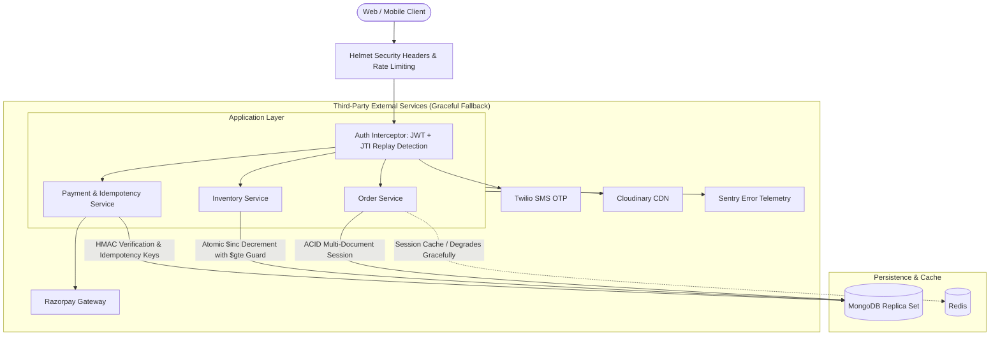

# Zipp Commerce

[](https://nodejs.org/)
[](https://expressjs.com/)
[](https://www.mongodb.com/)
[](https://redis.io/)
[](https://www.docker.com/)

A production-grade, layered quick-commerce backend (10-minute delivery model) designed for high concurrency, zero-overselling inventory guarantees, and defense-in-depth security.

---

## 1. Problem & Architectural Approach

Quick-commerce systems face acute consistency and concurrency hazards:
1. **Overselling During Flash Traffic:** Multiple concurrent users checking out the same last unit of an inventory item causes race conditions and inconsistent stock states.
2. **Payment Duplication & Webhook Desynchronization:** Network drops during checkout can trigger customer retries or out-of-order payment provider webhooks, risking double-charging or missed fulfillment.
3. **Session Hijacking & Token Replay:** Mobile-first commerce clients operating on public cellular networks are susceptible to token theft and replay attacks.

Zipp Commerce addresses these challenges via a decoupled **4-tier service architecture** (`routes` &rarr; `controllers` &rarr; `services` &rarr; `repositories`) with strict transactional consistency and graceful degradation across external dependencies.

---

## 2. System Architecture



---

## 3. Key Engineering Decisions

### ACID Order Processing & Concurrency Control
- **Atomic Stock Decrement:** Stock decrements use conditional MongoDB atomic updates (`$inc: { stock: -qty }` where `stock: { $gte: qty }`) wrapped in a MongoDB replica-set transaction. If any item in a multi-item cart fails the invariant, the transaction aborts, preventing partial orders and overselling.
- **Idempotent Payment Webhooks:** Incoming Razorpay webhooks verify SHA256 HMAC signatures. Event IDs are recorded in an idempotency collection with unique indexes, rendering retry webhooks safe and idempotent.

### Defense-in-Depth Authentication
- **Dual-Token Architecture:** Access tokens (short-lived, 15m) and Refresh tokens (long-lived, 7d) stored exclusively in `HttpOnly`, `SameSite: Strict` cookies.
- **JTI Rotation & Replay Lockout:** Every refresh token carries a unique JWT ID (`jti`). When a refresh token is used, its `jti` is invalidated and replaced. If a previously consumed `jti` is presented again, the system flags token theft, revokes the user's entire session family, and requires re-authentication.
- **Twilio OTP Verification:** Phone-based login utilizes constant-time comparison algorithms to mitigate timing attacks, combined with progressive IP and phone lockout policies.

### Graceful Degradation Design
The service handles infrastructure degradation without full application failure:
- **Redis Outage:** Caching and rate-limiting fall back seamlessly to in-memory ring buffers without blocking order placement.
- **Twilio SMS Outage:** Falls back to backup verification delivery in development/staging environments.
- **Cloudinary / Sentry Outage:** Asset uploads and telemetry degrade to local buffered logs without throwing unhandled exceptions to users.

---

## 4. Repository Structure

```
zipp-commerce/
├── backend/
│   ├── config/              # Database, Redis, and service configurations
│   ├── controllers/         # HTTP request orchestration and response formatting
│   ├── middleware/          # JWT auth, JTI validation, rate limiting, error handlers
│   ├── models/              # 13 Mongoose schemas (User, Order, Product, Category, etc.)
│   ├── routes/              # 16 route modules (auth, orders, cart, products, admin)
│   ├── services/            # Core business logic (inventory reservations, payments)
│   ├── utils/               # Seed scripts, indexing utilities, health checks
│   ├── server.js            # Express application bootstrap and graceful shutdown
│   └── package.json         # Dependencies and lifecycle scripts
├── frontend/                # Lightweight Vanilla JS / CSS3 responsive web client
├── Dockerfile               # Production container packaging
├── docker-compose.yml       # Full stack local orchestration (Node + Mongo + Redis)
└── render.yaml              # Cloud deployment specification
```

---

## 5. Getting Started

### Local Setup (Docker)
The recommended local development workflow uses Docker Compose:

```bash
# Clone the repository
git clone https://github.com/Sivaguru-2008/zipp-commerce.git
cd zipp-commerce

# Start backend, MongoDB, and Redis
docker-compose up --build
```

### Manual Setup
```bash
cd backend

# Install dependencies
npm install

# Configure environment
cp .env.example .env

# Seed initial product catalog
npm run seed

# Start server with hot-reload
npm run dev
```

Application endpoints will be available at `http://localhost:5000`.

---

## 6. Current Limitations & Roadmap

- **Horizontal Sharding:** Current stock decrement transactions rely on single-replica-set ACID guarantees; cross-shard distributed transactions require distributed two-phase commit or saga orchestration for multi-region scale.
- **Real-Time Rider Telemetry:** Delivery tracking currently uses polling; transition to WebSockets / SSE is planned for driver location streams.
